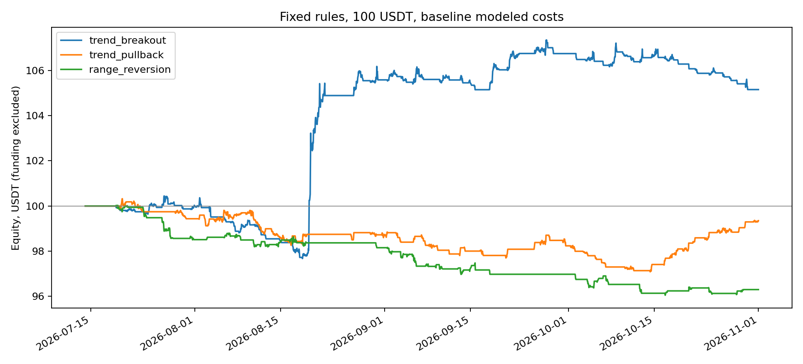

# Исследование стратегий для счёта 100 USDT

1 ноября 2026 года. **Это результаты исследовательских симуляций, а не подтверждённая прибыльность и не включённая торговая стратегия.**

## Цель и результат

Пожелания пользователя первоначально: счёт 100 USDT, небольшие просадки, обычное удержание от часа до четырёх, ориентир около двух прибыльных сделок на одну убыточную. Затем пользователь подтвердил новый приоритет: рост счёта после расходов с контролем просадки; срок и долю выигрышей оценивать по результатам без прежних жёстких ограничений. Последняя цель — **+10% капитала в месяц**, выбор способа и риска передан ассистенту. Бюджет остаётся 100 USDT. Просадка до 5% и риск на вход до 0,25% были начальными исследовательскими ориентирами; позднее отдельно проверены заранее описанные политики с риском до 1–2% и gross exposure до 3x. Это тестовые допущения, не включённое плечо на реальном счёте.

**Независимо подтверждённая стратегия с +10% в месяц пока не найдена.** В первых тринадцати фиксированных вариантах положителен по всей истории только более долгий пробой диапазона. В последующем сравнении восьми трендовых портфельных конфигураций лучший базовый итог — 119,85 USDT, но он не выдерживает требование стабильности по месяцам и чувствителен к расходам. Полные результаты всех конфигураций сохранены.

Проверены 474 840 закрытых минутных свечей из существующей базы: по 158 280 BTC, ETH и SOL, с 14 июля 02:00 до 31 октября 23:59 UTC. Полнота, последовательность и OHLC проверены локально. Сигналы рассчитываются по завершённым часовым свечам; исполнения проверяются по минутам. Будущее не используется в признаках. Для каждого варианта три монеты делят один счёт 100 USDT, без плеча, с максимум одной позицией на монету. Шаги количества взяты из текущего `src/contracts.ts`.

## Основные результаты

Базовые модельные расходы: комиссия 0,06% и неблагоприятное проскальзывание 0,03% **на сторону**, около 0,18% оборота позиции. Funding не включён. Доходность — изменение общей equity счёта, просадка учитывает открытые позиции на минутных закрытиях и предполагаемые расходы выхода.

| Вариант | Максимальное удержание | Сделки | Прибыльные после расходов | Итог счёта | Максимальная просадка |
|---|---:|---:|---:|---:|---:|
| Пробой 20-часового диапазона по тренду | 48ч | 60 | 20 / 60 = 33,3% | **105,15 USDT** | 2,92% |
| Откат к EMA20 в направлении тренда EMA100 | 24ч | 77 | 36 / 77 = 46,8% | 99,35 USDT | 3,41% |
| Возврат к средней в боковом режиме | 12ч | 73 | 32 / 73 = 43,8% | 96,30 USDT | 4,10% |
| Откат, более близкая цель | 12ч | 150 | 86 / 150 = 57,3% | 95,44 USDT | 6,12% |
| Боковик, более близкая цель | 12ч | 114 | 57 / 114 = 50,0% | 94,93 USDT | 5,88% |
| Короткий пробой | **4ч** | 153 | 69 / 153 = 45,1% | 95,63 USDT | 4,37% |
| Короткий откат | **4ч** | 168 | 76 / 168 = 45,2% | 94,71 USDT | 6,28% |
| Короткий возврат к средней | **4ч** | 115 | 49 / 115 = 42,6% | 95,38 USDT | 5,44% |
| Пробой с подтверждением объёмом, цель 0,8%, стоп 0,4% | **4ч** | 199 | 64 / 199 = 32,2% | 90,80 USDT | 9,30% |
| Относительное движение ETH/SOL, две противоположные позиции | **4ч** | 7 | 2 / 7 = 28,6% | 99,69 USDT | 0,49% |
| Ridge-прогноз с переобучением на прошлом, горизонт 4ч | 4ч | 35 | 10 / 35 = 28,6% | 97,96 USDT | 2,24% |
| Ridge-прогноз с переобучением на прошлом, горизонт 24ч | 24ч | 56 | 17 / 56 = 30,4% | 96,38 USDT | 4,54% |
| Ridge-прогноз с переобучением на прошлом, горизонт 48ч | 48ч | 49 | 13 / 49 = 26,5% | 97,90 USDT | 4,68% |

Стратегии и сценарии — альтернативные прогоны, а не независимые сделки одного портфеля. Их прибыль, число сделок и частоту выигрышей нельзя складывать.

У положительного пробоя фактически торгуются ETH и SOL: BTC не проходит минимальный ордер при бюджете 100 USDT и принятых ограничениях. Вклад ETH +3,046 USDT, SOL +2,105 USDT. Это результат общего счёта, не только SOL.

### Почему положительный пробой пока не решение

- Итог +5,151 USDT за примерно 110 суток, не в месяц. Медианное удержание 13,52 часа, максимальное 48 часов — пользовательский срок 1–4ч не соблюдается.
- Чистая прибыль 4,477 USDT одной сделки составляет около 87% общего net. Без неё остаётся +0,674 USDT; без трёх лучших — −2,357 USDT. Для трендовой стратегии редкие большие выигрыши естественны, но эта выборка недостаточна для доказательства устойчивости.
- Месячное изменение equity: июль (неполный) +0,006%, август +5,573%, сентябрь +1,102%, октябрь **−1,491%**. Основной рост сосредоточен в августе. Периоды идут хронологически, однако не являются нетронутой перспективной проверкой: проект уже наблюдал эту историю.
- При повышенных расходах (комиссия 0,08%, проскальзывание 0,07% на сторону) отдельный прогон заканчивается на 105,11 USDT; при тяжёлых 0,10% / 0,15% — 105,05 USDT. Прогоны различаются размерами, доступными ордерами и путями сделок: эти числа не доказывают нечувствительность одного фиксированного набора сделок к издержкам.
- Описательный bootstrap по семидневным блокам даёт диапазон изменения счёта примерно от −4,22% до +23,21%. Это чувствительность к выбору исторических блоков, не прогноз и не вероятность будущей прибыли. Нижняя граница отрицательна.

### Что означает ориентир «две прибыльные, одна убыточная»

Частота прибыльных сделок сама по себе не определяет рост счёта. При двух прибылях по 0,10 USDT и одном убытке 0,30 USDT результат отрицательный. Уменьшение цели иногда повышает процент выигрышей, но расходы и соотношение среднего выигрыша к проигрышу могут ухудшить результат. Именно это видно у отката с близкой целью: 57,3% плюсовых сделок, но итог −4,56%.

Ни один из проверенных вариантов не достиг одновременно положительного итога, примерно 2/3 прибыльных сделок, желаемого срока и устойчивости на позднем периоде. Перебирать цели до появления красивой цифры на этих же данных нельзя считать независимой проверкой.

## Точные правила и последовательность экспериментов

- [PROTOCOL.md](PROTOCOL.md): три исходные гипотезы и ограничения, записанные до выгрузки и прогона.
- [HIT_RATE_EXTENSION.md](HIT_RATE_EXTENSION.md): две новые гипотезы после пожелания о частоте выигрышей; исходные результаты сохранены.
- [SHORT_HOLD_PROTOCOL.md](SHORT_HOLD_PROTOCOL.md): три гипотезы после подтверждения срока 1–4ч.
- [VOLUME_PROTOCOL.md](VOLUME_PROTOCOL.md): отдельный пробой с подтверждением объёмом, целью 0,8%, стопом 0,4% и выходом максимум через 4ч.
- [PAIR_PROTOCOL.md](PAIR_PROTOCOL.md): относительное расхождение ETH/SOL, покупка отставшей монеты и продажа ушедшей вперёд с подобранными весами.
- [LEARNING_PROTOCOL.md](LEARNING_PROTOCOL.md): три прогноза с еженедельным переобучением на прошлом, после разрешения выбирать срок сделки по результатам.
- [PORTFOLIO_PROTOCOL.md](PORTFOLIO_PROTOCOL.md): ограниченное сравнение двух таймфреймов и четырёх политик риска/экспозиции под последнюю цель +10% в месяц.
- [OCTOBER_PROTOCOL.md](OCTOBER_PROTOCOL.md): отдельный октябрьский счёт 100 USDT без наследования позиций и прибыли.
- [ENTRY_SELECTION_PROTOCOL.md](ENTRY_SELECTION_PROTOCOL.md): один заранее заданный фильтр эффективности направленного движения перед входом; сравнение всей истории и отдельного октября.

Сначала тринадцать гипотез и 39 симуляций с тремя сценариями расходов; затем восемь заранее объявленных портфельных конфигураций и ещё 24 прогона. Одна конфигурация повторяет исходный трендовый baseline, то есть имеется 20 различных конфигураций и 60 различных комбинаций с расходами. Новые эксперименты используют ту же историю и сформулированы с учётом предыдущих наблюдений; это разведочное исследование, не подтверждение на независимых данных. Результаты ограниченного сравнения риска/таймфрейма ниже показаны все, без выбора только удачного месяца.

### Портфель под цель +10% в месяц

Каждый вариант объединяет BTC/ETH/SOL на одном счёте. Политика gross1 ограничивает суммарный notional размером equity; gross3 допускает гипотетическую экспозицию до 3x equity. Мин. количества и риск могут исключать BTC/ETH. Таймфрейм сигнала 1ч имеет лимит удержания 48ч; таймфрейм 4ч — **7 дней**. Это не сделки длительностью четыре часа.

Все строки ниже — базовые модельные расходы, до funding. Среднее — геометрическое изменение equity за полные август, сентябрь и октябрь. Июль неполный и исключён из этого среднего, но включён в итог счёта и просадку.

| Свечи | Риск на вход / gross cap | Итог, USDT | Макс. просадка | Среднее за полный месяц | Август | Сентябрь | Октябрь |
|---|---|---:|---:|---:|---:|---:|---:|
| 1ч | 0,25% / 1x | 105,15 | 2,92% | +1,69% | +5,57% | +1,10% | −1,49% |
| 1ч | 1% / 1x | 102,37 | 7,59% | +1,11% | +7,14% | +0,05% | −3,57% |
| 1ч | 1% / 3x | 111,44 | 17,58% | +5,17% | +31,09% | −3,49% | −8,07% |
| 1ч | 2% / 3x | 104,22 | 28,12% | +3,15% | +30,73% | −3,16% | −13,30% |
| 4ч | 0,25% / 1x | 101,24 | 1,18% | +0,41% | +1,24% | 0% | 0% |
| 4ч | 1% / 1x | 102,12 | 11,58% | +0,70% | +8,15% | −3,79% | −1,85% |
| 4ч | 1% / 3x | **119,85** | **10,90%** | **+6,22%** | **+24,59%** | **−3,10%** | **−0,73%** |
| 4ч | 2% / 3x | 112,98 | 29,73% | +4,15% | +37,65% | −7,96% | −10,82% |

Ни один вариант не достиг +10% среднего полного месяца; ни один не показал +10% в каждом полном месяце. Лучший базовый портфель содержит лишь 22 сделки, из них одна закрыта принудительно на конце исследованного периода. Медианное удержание — 58,8 часа. Одна LONG-сделка BTC с 18 по 25 августа принесла **14,505 USDT** из общего net 19,85; без неё остаётся +5,345 USDT, без трёх лучших — −6,721. Для этой BTC-сделки проверены все 10 081 минутная свеча от входа до выхода включительно: пропусков и разрывов между предыдущим close и следующим open нет. Это подтверждает согласованность кэша, но не внешнюю верификацию биржевых данных. При повышенных расходах итог портфеля падает до **103,60 USDT**, при тяжёлых — до **102,11**. Изменяются размеры и пути сделок, поэтому разницу нельзя приписать только прямому вычитанию комиссий из одного и того же списка сделок.

Увеличение риска до 2% не улучшило устойчивость и довело моделируемую просадку некоторых базовых портфелей примерно до 28–30%; при повышенных/тяжёлых расходах отдельные просадки ещё больше. Gross3 результаты не учитывают независимо проверенные maintenance margin, ликвидацию, funding и правила брокера. Поэтому даже положительный итог не доказывает исполнимость или пригодность реального плеча. Никакие такие настройки не активированы.

### Отдельный октябрь и выбор момента входа

По запросу пользователя проведены ещё 24 прогона тех же восьми портфелей: **новый счёт 100 USDT с 1 октября**, без позиций и прибыли из предыдущих месяцев. Более ранняя история только прогревает индикаторы. Это не новый независимый holdout — октябрь уже наблюдался.

| Свечи | Политика | Итог октября, USDT | Просадка | Сделки | Время полностью вне рынка, примерно |
|---|---|---:|---:|---:|---:|
| 1ч | 0,25% / 1x | 98,92 | 1,85% | 16 | 69,8% |
| 1ч | 1% / 1x | 95,61 | 8,08% | 30 | 59,9% |
| 1ч | 1% / 3x | 90,61 | 18,87% | 41 | 59,1% |
| 1ч | 2% / 3x | 86,47 | 27,12% | 44 | 53,5% |
| 4ч | 0,25% / 1x | 100,00 | 0% | 0 | 100% |
| 4ч | 1% / 1x | 98,07 | 4,06% | 8 | 41,8% |
| 4ч | 1% / 3x | **98,07** | **4,06%** | **8** | **41,8%** |
| 4ч | 2% / 3x | 92,00 | 13,25% | 11 | 41,8% |

При фиксированном бюджете некоторые политики дают одинаковые допустимые количества, поэтому результаты 4ч/1% с разными gross caps здесь совпали. Безубыточный вариант без единой сделки не считается найденной прибыльной стратегией.

Затем проверен **один фиксированный фильтр входа**: эффективность пути за последние 20 закрытых баров >=0,40. Он измеряет, насколько движение было направленным, а не состояло из колебаний туда-сюда. Признак вычисляется до входа; проигравшие сделки задним числом не удаляются. Этот отдельный эксперимент даёт 12 прогонов (два таймфрейма × вся история/октябрь × три сценария расходов).

| Фильтр, базовые расходы | Счёт за всю историю | Счёт за отдельный октябрь | Сделки октября | Вне рынка в октябре |
|---|---:|---:|---:|---:|
| 1ч, риск1/gross3 | 115,64 | 95,65 | 22 | 78,3% |
| 4ч, риск1/gross3 | 113,70 | **96,91** | **4** | **78,3%** |

Более редкие входы **не исправили октябрь**. У 4ч фильтра движение цены дало примерно −2,925 USDT, а расходы — около 0,163, итог −3,088. Здесь основная проблема — уже качество направления/выходов, а не только комиссии. Это отличается от коротких стратегий, где движение до расходов было около нуля и доминировали расходы.

На всей истории 4ч фильтр также ухудшил базовый итог и стал отрицательным при повышенных расходах. Поэтому он не заменяет исходный кандидат и не включён в замороженный forward-протокол. Доля времени в рынке рассчитана по объединению модельных интервалов позиций, с минутной точностью; точного внутриминутного времени и очереди исполнения нет.

### Модели с хронологическим переобучением

По каждой монете отдельно ridge-регрессия прогнозирует доходность на горизонте 4/24/48ч. Признаки — только доступные к моменту решения доходности, EMA/ATR, диапазон, объём и движение относительно BTC. Масштабирование обучается только на прошлом; последние ещё неизвестные исходы исключены из обучения. Переобучение раз в неделю, окно до 45 дней, регуляризация и порог входа фиксированы заранее. Первые прогнозы начинаются в сентябре после накопления обучения; июль/август с нулевым торговым результатом в этой таблице не являются успешными месяцами модели.

Все три горизонта убыточны после базовых расходов: 4ч **−2,045 USDT**, 24ч **−3,616**, 48ч **−2,097**. Повышенные расходы не устраняют убыток. Ошибки прогнозов и корреляции сохранены отдельно; по MAE все девять комбинаций монета/горизонт хуже простого прогноза среднего движения на том же окне. Следовательно, усложнение правила до обучаемой модели на этих признаках не подтвердило улучшения предсказания.

Прогнозы сделаны последовательно без знания соответствующих будущих исходов, но весь период уже просмотрен проектом: это внутренняя хронологическая проверка, а не новый независимый forward-тест. Поиск другой модели на этих же результатах будет новым исследованием с риском подгонки.

### Парная гипотеза ETH/SOL

Это другой источник возможного преимущества: сближение относительных цен вместо прогноза направления рынка. На предыдущих 168 часах строится регрессия log(ETH) на log(SOL); на завершённом текущем часе проверяется отклонение от этого прошлого соотношения. Коэффициенты и уровни фиксируются при входе. Используются фильтры beta, корреляции часовых доходностей, описательного периода полураспада остатка и достаточного отклонения относительно расходов. Это не доказательство коинтеграции или рыночной нейтральности.

Получено 66 сигналов: 49 отклонены из-за сочетания минимальных количеств, точности хеджирования и лимита риска; ещё 10 приходятся на открытую/только закрытую пару. На счёте 100 USDT исполнено 7 парных сделок. Каждая включает две позиции; ограничения и расходы применены к общему счёту.

Базовое разложение: движение цен **+0,1776 USDT**, комиссии **0,3251**, модельное проскальзывание **0,1626**, итог **−0,3101 USDT**. При повышенных издержках −0,6352 USDT; при тяжёлых — только одна допустимая сделка и −0,1374 USDT. Меньший убыток тяжёлого сценария объясняется почти полным отказом от сделок из-за размеров/риска, а не устойчивостью преимущества. Медианное удержание — 240 минут: ожидаемое сближение часто не успевает произойти за желаемый срок.

**Кандидат не прошёл отбор:** после расходов отрицателен, выборка всего семь сделок, практическая исполнимость при бюджете мала. Маленькая просадка в этой выборке не доказывает безопасность. Оценка риска пары приблизительна; она не защищает от разрыва корреляции. Уровни пары наблюдаются по минутным закрытиям с исполнением на следующем открытии; внутриминутные экстремумы двух инструментов и задержки одной ноги неизвестны. Funding также исключён.

### Отдельный результат фильтра объёма

Требование часового объёма >=1,5 медианы предыдущих 20 часов почти не сокращает число пробоев: ETH 91 из 99 исходных сигналов, SOL 113 из 131. Это не независимое доказательство силы сигнала: пробои и так часто сопровождаются повышенным объёмом.

При базовых расходах 199 сделок дают: движение цены без расходов **−0,035 USDT**, комиссии **6,110 USDT**, проскальзывание **3,055 USDT**, итог **−9,200 USDT**. Каждый исследованный месяц отрицателен. При повышенных расходах итог −14,757 USDT, при тяжёлых −23,922 USDT. Ориентир просадки 5% нарушен даже в базовом сценарии. Это критерий отклонения; симуляция намеренно не содержит аварийного остановa на 5% и показывает поведение исходного правила.

Вариант **отклонён**. Цель 0,8% сама по себе не обеспечивает преимущество: важны вероятность её достижения, убыточные выходы и оборот. Данных о историческом спреде/очереди в свечном кэше нет; преимущество лимитного исполнения не проверено и не заявляется.

## Исполнение, риски и ограничения

- Вход только на следующем часовом открытии после сигнала. Начальный стоп проверяется уже в минуте входа. При одновременном касании стопа и цели выбран стоп; разрыв через стоп исполняется по неблагоприятному открытию. Изменение трейлинг-стопа после часового закрытия действует со следующей минуты.
- Комиссия входа списывается сразу, выхода — при закрытии. Размер позиции округляется вниз до шага. Риск на вход включает модельный стоп и расходы; реальный разрыв цены может превысить этот риск.
- Максимальный gross notional на монету — треть equity, общий — не выше equity. Счёт не использует плечо. Минимальные количества статичны из репозитория; биржевые ограничения независимо не обновлялись.
- Просадка измеряется по минутным закрытиям; внутриминутная просадка может быть больше. Уровень 5% — критерий оценки, а не гарантия или реализованный аварийный останов.
- Funding неизвестен. Попытка чтения публичной истории Bybit из среды получила HTTP 403. Синтетическая чувствительность «всегда платить 0,01% каждые 8ч» на сохранённых позициях уменьшает итог положительного пробоя примерно на 0,233 USDT. Это допущение, не замена фактического funding.
- Свечной симулятор не моделирует очередь, глубину стакана, динамический спред, задержки и точный порядок тиков. Маржинальные/ликвидационные правила биржи не воспроизведены; ограничение notional консервативно, но не доказывает исполнимость.
- Итоги не обещают доходности, отсутствия убыточных недель или определённой последовательности выигрышей.

## Почему инверсия тоже может давать минус

Дополнительно выполнено точное контрфактическое сравнение: **те же входы, выходы и количества**, но противоположное направление. Опорные цены восстановлены из модели проскальзывания, комиссии и неблагоприятное исполнение посчитаны заново. Это изоляция расходов, не новая исполнимая стратегия с собственными стопами и балансом.

Для короткого пробоя за 153 сделки:

| Компонент | Исходное направление | Инверсия при тех же временах |
|---|---:|---:|
| Движение цены до расходов | −0,022 USDT | +0,022 USDT |
| Комиссии и проскальзывание | около 4,351 USDT | около 4,351 USDT |
| Итог | **−4,374 USDT** | **−4,329 USDT** |

Здесь около **99,5% абсолютного убытка исходного прогона приходится на модельные расходы**. Сигнал до расходов почти нейтрален. Переворот превращает −0,022 в +0,022, но сохраняет около 4,35 расходов. Именно поэтому обе версии убыточны.

Другой пример — исходный откат с 24ч лимитом: движение цены +1,327 USDT, расходы 1,976, итог −0,649. При инверсии движение становится −1,327, расходы остаются около 1,976, итог −3,302 USDT.

Если расходы равны C, результат при исходном направлении G−C, при обратном −G−C. При |G|<C оба отрицательны. Переворот всей стратегии с новыми стопами и тейками дополнительно меняет времена сделок и не даёт точного зеркала. На этих данных проблема короткого пробоя — отсутствие достаточного ценового преимущества относительно частоты оборота и расходов; это не арифметическая ошибка начисления комиссии.

Полные результаты — `inversion-results.json`, расчёт — `inversion.py`. Его суммы сверены с тождеством: исходный net + обратный net = минус сумма расходов обоих гипотетических вариантов. Funding по-прежнему исключён.

## Следующий обоснованный шаг

Не включать ни один из коротких вариантов в качестве найденной прибыльной стратегии. Сохранить долгий пробой как контрольный ориентир и оставить его параметры неизменными, если потребуется дальнейший paper-тест.

Простая проверка повышенного объёма, относительная торговля ETH/SOL и линейный прогноз на текущих признаках уже проверены и не прошли отбор на бюджете 100 USDT. После разрешения более длинного удержания остаётся трендовое семейство как исследовательский кандидат, но ограниченное сравнение риска/экспозиции не подтвердило цель +10% в месяц. Следующий способ получить новое доказательство — отдельный forward paper-период с заранее зафиксированными правилами и учётом реального funding/исполнения. Любой дальнейший поиск другой модели требует обоснования новых признаков и нового протокола, а не только смены алгоритма обучения. Бесконечный перебор индикаторов или наращивание риска на просмотренной истории не создают независимого подтверждения.

Новая перспективная проверка начинается после фиксации правил, на входах после её начала. Короткие варианты этой работы отклонены на исследовательском этапе. Продолжающийся сбор свечей остаётся полезным.

### Подготовленная проверка на будущих данных

[FORWARD_PROTOCOL.md](FORWARD_PROTOCOL.md) фиксирует отдельный paper replay выбранного 4ч портфеля с **2 ноября 2026, 00:00 UTC**, счёт 100 USDT и неизменные параметры risk1/gross3. `forward_study.py --refresh` читает только существующий API коллектора, обновляет отдельный кэш и пересчитывает виртуальный счёт. Старый исторический кэш не меняется; ранее записанные будущие свечи не могут тихо переписываться.

На 1 ноября данных этого будущего периода ещё нет: runner возвращает `waiting-for-forward-data`. Сам runner не работает как фоновый сервис: для обновления его нужно выполнить вручную или отдельной задачей автоматизации. Действующая production-система не получила новую стратегию. Промежуточный отчёт оставляет открытые позиции открытыми, учитывая их оценку, вместо фиктивного закрытия на конце каждого отчёта.

Замороженный критерий бумажного обзора: минимум **три полных положительных месяца**, геометрическое среднее **>=10% в месяц**, минимум **30 закрытых сделок**, максимальная минутная просадка **<=15%**. Порог просадки выбран ассистентом для исследования после передачи выбора риска пользователем; это не обещание безопасности и не команда останавливать расчёт и скрывать дальнейший убыток. Ноябрь начинается со второго числа, поэтому первый возможный обзор трёх полных месяцев — после окончания февраля. Funding, ликвидации и реальная стоимость исполнения остаются обязательными нерешёнными ограничениями перед любым продвижением, даже при выполнении бумажных критериев.

## Как воспроизвести и видеть работу

```sh
python3 -m venv .venv
.venv/bin/pip install -r requirements.txt
.venv/bin/python download.py
.venv/bin/python screen.py
.venv/bin/python robustness.py
.venv/bin/python hit_rate.py
.venv/bin/python short_hold.py
.venv/bin/python inversion.py
.venv/bin/python volume_study.py
.venv/bin/python pair_study.py
.venv/bin/python learning_study.py
.venv/bin/python portfolio_study.py
.venv/bin/python october_study.py
.venv/bin/python entry_study.py
.venv/bin/python verify_forward.py
# После наступления будущего периода, для явного обновления отдельного paper-отчёта:
.venv/bin/python forward_study.py --refresh
```

`download.py` читает только существующий публичный отчёт приложения дневными окнами, не более двух запросов одновременно, и сохраняет кэш в `data/`. В нём нет SQL-доступа, ордеров или изменения конфигурации. `data-manifest.json` фиксирует SHA-256 всех 330 файлов исходной выборки. Коррекции базы могут изменить повторную выгрузку — сравнить манифесты перед сравнением результатов.

В ходе выполнения скрипты печатают завершённые варианты. Перенаправление `> run.log 2>&1` сохраняет журнал; `tail -f run.log` показывает его пополнение. Моментальный просмотр файла по ссылке не является автоматически обновляющимся интерфейсом.

Выходы: `results.json`, `hit-rate-results.json`, `short-hold-results.json`, `volume-results.json`, `pair-results.json`, `learning-results.json`, `forecast-metrics.json`, `learning-audit.json`, `portfolio-results.json`, `october-results.json`, `entry-selection-results.json`, `robustness.json`, `inversion-results.json`, CSV сделок и equity, `equity.png`. В репозитории сохранены код, протоколы, сводные результаты, манифест и график; объёмные исходные свечи и подробные CSV — в локальном архиве исследования.



## Проверки

Успешно выполнены проверки непрерывности времени, уникальности и OHLC всех 474 840 свечей; совпадения сигналов и ATR на префиксе с расчётом на полной истории; неблагоприятного исполнения гэпов и приоритета стопа; расходов плоской сделки; лимитов размера/риска; согласования cash с суммой сделок; разложения P&L. Дополнительные гипотезы не изменили исходный baseline. Во всех вариантах с лимитом 4ч и сценариях максимальное удержание не превышает 240 минут. Для объёма проверены совпадение времён с ценовыми свечами, конечность/неотрицательность и исключение текущего часа из медианы сравнения.

Для парной модели отдельно проверены неизменность сигналов при добавлении будущих часов, исполнение после наблюдаемого события, лимиты общего notional и приближённого риска, расхождение весов хеджа <=10%, согласование cash/расходов и удержание <=240 минут. Парная модель использует описанную выше отдельную логику минутных событий, а не внутриминутные защитные уровни одноинструментного движка.

Для обучаемых моделей проверены временные границы доступности каждой тренировочной метки, обучение масштабирования на train, независимый пересчёт признаков без последних 300 часов, неизменность общих более ранних прогнозов при удалении будущих часов и стандартные проверки торгового движка. В `learning-audit.json` сохранены времена последних доступных меток каждого переобучения.

Перед сравнением портфелей исходный 1ч baseline повторно совпал с сохранённым результатом. Проверены полные 4ч блоки, неизменность признаков/сигналов на префиксе и лимиты риска/notional каждой политики. Смена риска не переписывает старые результаты. Маржинальная/ликвидационная модель этими арифметическими проверками не подтверждается.

Проверка промежуточного forward-учёта подтверждает: входная комиссия открытой позиции списана; закрытая прибыль не выдумана; оценка открытой позиции совпадает с модельной ликвидационной стоимостью; позиция не закрывается просто из-за конца отчёта. Сам prospective runner до даты старта сообщает ожидание данных.

Python-исследование изолировано от production Node.js приложения. Запуск или деплой торгового кода не выполнялся.
